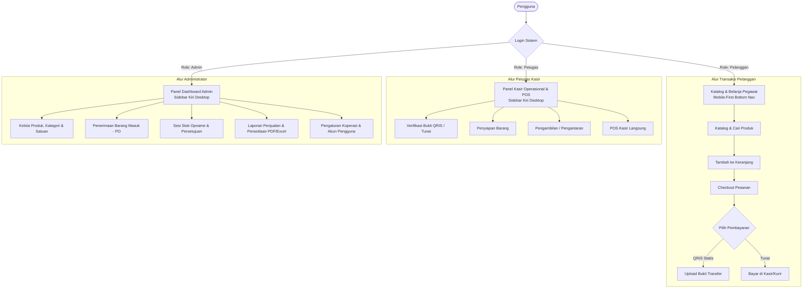

# DOKUMENTASI TEKNIS & PANDUAN PENGGUNA SISTEM INFORMASI E-KOPERASI

**Versi:** 1.0  
**Tanggal:** 9 November 2026  
**Framework:** Laravel 10 (PHP 8.2+)  
**Database:** MySQL (InnoDB, utf8mb4)  
**Frontend Stack:** Blade, Livewire 3, Alpine.js, Bootstrap 5, Bootstrap Icons  

---

## 1. PENDAHULUAN & IDENTITAS VISUAL

Sistem Informasi E-Koperasi dirancang untuk digitalisasi operasional koperasi kantor secara menyeluruh, mencakup pemesanan digital mandiri oleh pegawai, pelayanan kasir cepat (Point of Sale), verifikasi transaksi pembayaran (QRIS statis & Tunai), pengendalian persediaan stok otomatis, audit mutasi stok, serta sesi stok opname khusus Administrator.

### Palet Warna Identitas Visual (Design System)
Sistem menerapkan identitas visual terpadu sesuai standar PRD:
- **Hijau Utama (`#16834A`):** Warna primer untuk branding koperasi, tombol aksi utama, header navigasi, dan indikator sukses.
- **Kuning (`#F5C542`):** Warna aksen untuk status pending/menunggu, sorotan badge, dan banner promosi.
- **Putih (`#FFFFFF`):** Latar belakang kartu konten, dropdown, tabel, dan formulir.
- **Abu-abu Muda (`#F4F6F8`):** Warna latar belakang dashboard dan halaman customer.
- **Teks Gelap (`#252B33`):** Tipografi utama berkarakter modern dan berorientasi keterbacaan tinggi.
- **Merah (`#DC3545`):** Indikator peringatan stok menipis/habis, pembatalan pesanan, dan penolakan verifikasi pembayaran.
- **Tipografi:** *Plus Jakarta Sans* / *Inter*.

---

## 2. ARSITEKTUR TIGA ROLE PENGGUNA



---

## 3. STRUKTUR DATABASE LENGKAP (19 TABEL)

Sistem menggunakan database MySQL engine InnoDB dengan foreign key constraints dan relasi integritas:

| No | Nama Tabel | Keterangan & Relasi |
|---|---|---|
| 1 | `roles` | Menyimpan jenis peran pengguna (`admin`, `petugas`, `pelanggan`). |
| 2 | `users` | Akun pengguna lengkap dengan kolom `role_id`, `name`, `email`, `phone`, `employee_id` (NIP/ID Pegawai), `password`, `is_active`. |
| 3 | `categories` | Kategori produk dengan `slug`, `icon` bootstrap, dan status `is_active`. |
| 4 | `units` | Master satuan kemasan barang (`Pcs`, `Btl`, `Bks`, `Box`, `Rim`, `Klg`, dll). |
| 5 | `products` | Katalog produk, `code`/SKU, `purchase_price` (HPP), `sell_price`, `stock`, `min_stock`, `image`, `is_active`. |
| 6 | `carts` | Relasi one-to-one ke `users` untuk wadah keranjang belanja pengguna. |
| 7 | `cart_items` | Rincian item di dalam keranjang (`cart_id`, `product_id`, `quantity`). |
| 8 | `orders` | Induk transaksi pesanan dengan nomor unik (`ORD-YYYYMMDD-XXXX` atau `POS-YYYYMMDD-XXXX`), `order_type` (`pickup`, `delivery`, `pos`), status pesanan, dan status pembayaran. |
| 9 | `order_items` | Snapshot data item pesanan (`product_name`, `product_code`, `price` saat transaksi, `quantity`, `subtotal`). |
| 10 | `payments` | Catatan transaksi pembayaran, `amount`, `payment_method` (`qris`/`cash`), `proof_image`, `status`, `rejection_reason`, `verified_by`, `verified_at`. |
| 11 | `deliveries` | Detail pengantaran ke ruangan pegawai (`courier_name`, `recipient_name`, `recipient_phone`, `delivery_address`, `status`, `delivered_at`). |
| 12 | `stock_movements` | Audit log pergerakan stok: `type` (`in`, `out`, `adjustment`), `reference_type` (`purchase`, `order`, `opname`, `manual`, `initial`), `quantity`, `stock_before`, `stock_after`. |
| 13 | `stock_opnames` | Sesi stok opname khusus admin (`opname_number`, `created_by`, `approved_by`, `status` [draft, reviewed, approved, rejected], `approved_at`). |
| 14 | `opname_details` | Rincian penghitungan stok per produk: `system_stock`, `physical_stock`, `difference` (selisih). |
| 15 | `suppliers` | Data mitra pemasok barang (`code`, `name`, `contact_person`, `phone`, `email`, `address`). |
| 16 | `purchases` | Faktur penerimaan pasokan barang masuk (PO) dari supplier (`purchase_number`, `purchase_date`, `total_amount`, `invoice_number`). |
| 17 | `purchase_items` | Rincian item pasokan barang (`product_id`, `quantity`, `unit_price`, `subtotal`). |
| 18 | `order_status_histories` | Jejak audit histori perubahan status pesanan (`order_id`, `user_id`, `status`, `notes`). |
| 19 | `settings` | Pengaturan dinamis sistem (identitas koperasi, alamat, kontak, konfigurasi merchant & barcode QRIS). |

---

## 4. AKUN DEFAULT & HAK AKSES PENGGUNA

Sistem telah dilengkapi seeder akun awal untuk pengujian dan operasional:

| Role | Email Login / NIP | Password | Tampilan & Hak Akses Utama |
|---|---|---|---|
| **Administrator** | `admin@koperasi.com` / `ADM-001` | `password` | Dashboard Admin, CRUD Produk, Kategori, Satuan, Monitoring Persediaan, PO Barang Masuk, Stok Opname & Approval, Laporan PDF/CSV, Manajemen Pengguna & Pengaturan QRIS. |
| **Petugas / Kasir** | `petugas@koperasi.com` / `KAS-002` | `password` | Dashboard Kasir, Mesin Kasir POS Langsung, Cetak Struk Kasir, Verifikasi QRIS/Tunai, Pemrosesan Antrean Pesanan Siap Ambil / Diantar, Cek Stok. |
| **Pelanggan (Pegawai)** | `pegawai@koperasi.com` / `PEG-10492` | `password` | Mobile-first UI toko pegawai, Katalog Produk, Filter Kategori, Keranjang Belanja Dinamis, Checkout Ambil Sendiri / Antar Ruangan, Upload Bukti QRIS, Lacak Status Pesanan. |

---

## 5. FITUR-FITUR UTAMA SISTEM

### A. Modul Pelanggan / Pegawai
1. **Navigasi Mobile-First & Tanpa Reload:**
   - Navigasi bawah (*bottom navigation*) tetap di layar ponsel (Beranda, Produk, Keranjang, Pesanan, Profil).
   - Seluruh interaksi keranjang belanja, kuantitas item, dan filter katalog menggunakan **Laravel Livewire 3** tanpa memuat ulang halaman (*zero full page reload*).
2. **Katalog & Keranjang Belanja:**
   - Pencarian instan berdasarkan nama, barcode, atau deskripsi.
   - Indikator ketersediaan stok (Tersedia, Stok Menipis, Stok Habis).
   - Validasi otomatis mencegah pesanan melebihi stok yang tersedia di database.
3. **Checkout Fleksibel:**
   - **Pilihan Layanan:** Ambil Sendiri (*Pickup*) di etalase kasir atau Antar ke Ruangan (*Delivery*) dengan mencantumkan nama penerima, kontak, dan nomor meja kerja.
   - **Metode Pembayaran:** QRIS Statis Koperasi atau Tunai (*Cash*).
   - Eksekusi transaksi menggunakan **database transaction** dan **row-level locking** (`lockForUpdate`) untuk mencegah kondisi balapan (*race condition*) dan stok minus.
4. **Instruksi Pembayaran & Upload Bukti QRIS:**
   - Tampilan barcode QRIS resmi koperasi beserta NMID dan nominal tagihan tepat.
   - Unggah foto/screenshot bukti transfer dengan batasan format gambar dan validasi ukuran (maksimal 3MB).
   - Status otomatis berubah menjadi `waiting_verification`.
   - Jika pembayaran ditolak kasir, alasan penolakan ditampilkan dengan jelas dan pelanggan dapat mengunggah ulang bukti baru.

### B. Modul Petugas / Kasir
1. **Mesin Kasir Cepat (Point of Sale - POS):**
   - Transaksi langsung bagi pembeli yang datang ke toko koperasi.
   - Filter pencarian cepat barcode dan kategori produk.
   - Kalkulasi otomatis total tagihan, input nominal uang tunai diterima, dan hitung kembalian (*change*).
   - Cetak struk kasir (*thermal receipt style*) langsung ke printer kasir (`window.print()`).
2. **Verifikasi Pembayaran QRIS & Tunai:**
   - Tinjauan daftar pembayaran yang membutuhkan persetujuan (*waiting verification*).
   - Fitur modal perbesar pratinjau bukti transfer transfer untuk pencocokan dengan mutasi bank/merchant.
   - Tombol **ACC** (menandai lunas, mencatat verifikator dan waktu verifikasi).
   - Tombol **Tolak** dengan kewajiban mengisi alasan penolakan.
3. **Manajemen Antrean Pesanan:**
   - Pelacakan alur: *Confirmed* &rarr; *Processing* (Mulai Penyiapan) &rarr; *Ready for Pickup* / *On Delivery* &rarr; *Completed*.
   - Manajemen nama kurir/petugas pengantar untuk pesanan antar ruangan.

### C. Modul Administrator
1. **Dashboard & Visualisasi:**
   - Kartu statistik omzet bulanan, jumlah pesanan, total katalog, dan total pegawai.
   - Grafik interaktif tren penjualan harian menggunakan **Chart.js**.
   - Notifikasi dini stok produk yang menipis.
2. **Katalog & Persediaan Terpadu:**
   - CRUD Produk lengkap dengan pengaturan harga beli (HPP), harga jual, stok minimum, dan unggah foto produk.
   - CRUD Kategori dan Satuan barang dagangan.
   - Penerimaan Barang Masuk (PO Supplier) yang otomatis menambah stok dan mencatat mutasi masuk.
   - Master data mitra pemasok (Supplier).
   - Audit trail mutasi stok (`stock_movements`) untuk melacak asal-usul setiap penambahan atau pengurangan barang.
3. **Modul Stok Opname Khusus Admin:**
   - Membuat sesi opname baru dengan mengambil snapshot stok database saat sesi dimulai.
   - Input hasil penghitungan fisik nyata di toko.
   - Sistem secara otomatis menghitung selisih (*difference = physical - system*).
   - Admin meninjau dan memberikan persetujuan (*Approval*).
   - Saat disetujui, stok produk otomatis diperbarui dan dicatat sebagai mutasi penyesuaian (*adjustment*).
4. **Laporan & Ekspor Data:**
   - Laporan Penjualan terfilter periode tanggal (Omzet, Total Struk, Rata-rata Belanja, Produk Terlaris).
   - Laporan Persediaan Stok dan total nilai aset modal (HPP) vs potensi nilai jual.
   - Ekspor format **PDF resmi siap cetak** menggunakan DomPDF.
   - Ekspor format **Excel (CSV dengan UTF-8 BOM)**.
5. **Pengaturan & Akun:**
   - Manajemen akun pengguna: Admin, Petugas, Pelanggan (Tambah, Edit, Aktifkan/Nonaktifkan).
   - Pengaturan profil koperasi dan unggah gambar barcode QRIS statis resmi.

---

## 6. CARA INSTALASI & MENJALANKAN SISTEM

### Prasyarat
- PHP 8.2 atau lebih baru (ekstensi: pdo_mysql, mbstring, gd/fileinfo)
- MySQL Server (misal melalui Laragon / XAMPP)
- Composer

### Langkah Instalasi
1. Masuk ke direktori proyek:
   ```bash
   cd "D:\E Koperasi"
   ```

2. Konfigurasi file `.env`:
   Pastikan pengaturan koneksi database MySQL sudah sesuai:
   ```env
   DB_CONNECTION=mysql
   DB_HOST=127.0.0.1
   DB_PORT=3306
   DB_DATABASE=ekoperasi
   DB_USERNAME=root
   DB_PASSWORD=
   ```

3. Jalankan migrasi database dan seeder data awal:
   ```bash
   php artisan migrate:fresh --seed
   ```

4. Pastikan storage symbolic link sudah terhubung:
   ```bash
   php artisan storage:link
   ```

5. Jalankan web server Laravel:
   ```bash
   php artisan serve
   ```
   Akses aplikasi di browser melalui URL: `http://localhost:8000`

---

## 7. CHECKLIST PENGUJIAN AKSEPTASI (ACCEPTANCE CRITERIA)

| Kriteria Pengujian (PRD Section 12) | Status | Bukti Implementasi |
|---|---|---|
| 1. Pengguna dapat login dan diarahkan ke tampilan sesuai role | **LULUS** | `AuthController` & `RedirectIfAuthenticated` mengarahkan Admin ke `/admin/dashboard`, Petugas ke `/petugas/dashboard`, Pelanggan ke `/customer`. |
| 2. Pelanggan dapat melihat dan mencari produk | **LULUS** | Komponen `ProductCatalog` dan `Home` dengan pencarian debounce instan. |
| 3. Pelanggan dapat memasukkan produk ke keranjang | **LULUS** | Tombol "Tambah ke Keranjang" tanpa reload halaman pada Livewire. |
| 4. Sistem menghitung total belanja secara benar | **LULUS** | Subtotal dan total dihitung otomatis real-time di keranjang dan checkout. |
| 5. Sistem menolak checkout jika stok tidak mencukupi | **LULUS** | Validasi ketersediaan stok di keranjang dan locking `lockForUpdate` di `CheckoutView`. |
| 6. Pelanggan dapat membuat pesanan | **LULUS** | `CheckoutView` menghasilkan nomor unik `ORD-YYYYMMDD-XXXX`. |
| 7. Pelanggan dapat memilih metode QRIS dan Tunai | **LULUS** | Radio pilihan metode bayar QRIS / Cash di form checkout. |
| 8. Bukti QRIS tersimpan dan dapat diperiksa petugas | **LULUS** | Upload via Livewire disimpan ke storage publik dan ditampilkan di antrean verifikasi kasir. |
| 9. Petugas dapat menyetujui atau menolak pembayaran | **LULUS** | Komponen `PaymentVerification` dengan tombol ACC dan Tolak (wajib alasan penolakan). |
| 10. Pesanan tidak dapat diproses sebelum pembayaran dikonfirmasi | **LULUS** | Validasi status pembayaran `paid` sebelum petugas dapat mengubah status ke `processing`. |
| 11. Petugas dapat memproses pesanan hingga selesai | **LULUS** | Alur status: `confirmed` &rarr; `processing` &rarr; `ready_for_pickup` / `on_delivery` &rarr; `completed`. |
| 12. Stok berubah sesuai aturan dan seluruh pergerakan tercatat | **LULUS** | Tabel `stock_movements` mencatat pergerakan stok keluar, masuk, dan penyesuaian. |
| 13. Hanya Admin yang dapat melakukan stok opname | **LULUS** | Rute `/admin/stock-opname/*` dilindungi middleware `role:admin`. |
| 14. Admin dapat menyetujui hasil opname dan sistem memperbarui stok | **LULUS** | Method `approveOpname` di `OpnameDetailView` menyinkronkan stok produk dengan hasil fisik. |
| 15. Laporan penjualan dapat ditampilkan sesuai periode | **LULUS** | Komponen `SalesReport` dengan filter rentang tanggal `startDate` dan `endDate`. |
| 16. Navigasi tanpa full page reload pada tampilan pelanggan | **LULUS** | Penerapan atribut `wire:navigate` pada link menu pelanggan. |
| 17. Tampilan responsif untuk smartphone dan desktop | **LULUS** | Bottom navigation khusus mobile dan fluid desktop grid dengan Bootstrap 5. |
| 18. Pengguna dibatasi hak akses berdasarkan perannya | **LULUS** | `RoleMiddleware` memblokir akses ke rute di luar kewenangan role pengguna. |

